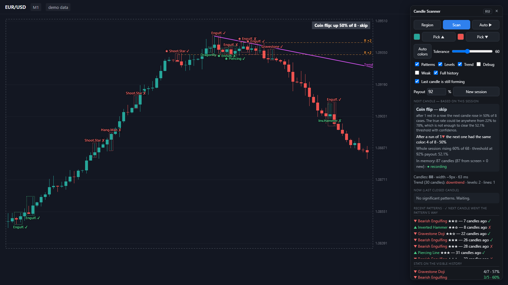
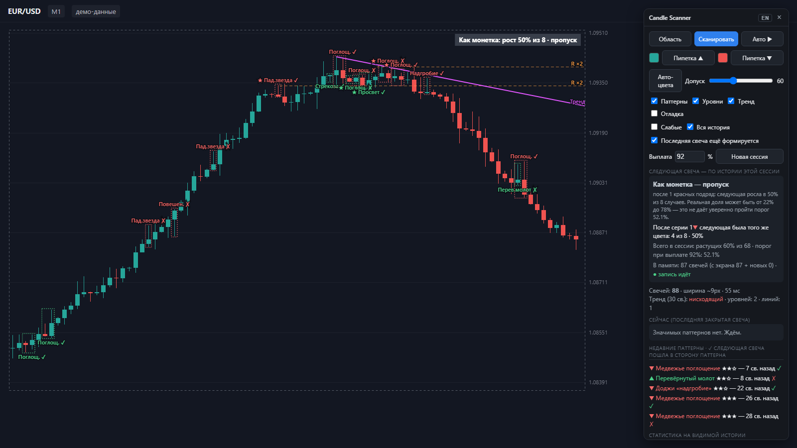

# Candle Scanner — candlestick pattern recognition, support/resistance levels and trend lines right on your browser chart

**Free Chrome extension (also Edge, Brave, Opera, Yandex Browser) that automatically finds candlestick patterns, support and resistance levels and trend lines on any web chart: your broker, TradingView, a crypto exchange and more.**

**Бесплатное расширение для браузера: само находит свечные паттерны, уровни поддержки и сопротивления и трендовые линии на любом графике.** [Читать на русском ↓](#русский)

**Contents / Содержание**
- [English](#english)
- [Русский](#русский)

---

## English

### What it is

Candle Scanner takes the routine out of chart analysis. You no longer need to draw trend lines by hand, hunt for support and resistance, or squint at every candle to spot a hammer or an engulfing pattern. The extension takes a screenshot of the visible tab, recognizes the candles and annotates the chart right away.

It works on **any website with a candlestick chart**, because it reads the image, not the data. No broker API, keys or login are needed. Forex, crypto, stocks, OTC pairs and binary options platforms all work.

The interface is available in **English and Russian**. It follows your browser language, and you can switch it with the **RU / EN** button in the panel header.

> ⚠️ **This is not a trading signals tool.** It does not tell you when to buy or sell. It only saves you from drawing lines and searching for the textbook candlestick shapes described in classic technical analysis literature. All decisions are yours. See the [Disclaimer](#disclaimer).

### What it detects

**Candlestick patterns (21):**

| Bullish reversal | Bearish reversal | Neutral and momentum |
|---|---|---|
| Hammer | Hanging Man | Doji |
| Inverted Hammer | Shooting Star | Dragonfly Doji |
| Bullish Engulfing | Bearish Engulfing | Gravestone Doji |
| Bullish Harami | Bearish Harami | Bullish Marubozu |
| Piercing Line | Dark Cloud Cover | Bearish Marubozu |
| Tweezer Bottom | Tweezer Top | |
| Morning Star | Evening Star | |
| Three White Soldiers | Three Black Crows | |

Patterns follow the classic rules (Steve Nison, Thomas Bulkowski) and take the preceding trend into account. For example, a hammer and a hanging man look the same, but the first appears after a decline and the second after a rally.

**Chart markup:**
- **Support (S) and resistance (R) levels** with touch counts.
- **Trend lines**: through lows in an uptrend, through highs in a downtrend. A possible breakout is marked.
- **Overall trend**: up, down or sideways over the last 30 candles.
- **Pattern strength** ★☆☆–★★★: the classic significance of the shape plus a bonus when it forms at a level.

**Statistics instead of guessing:**
- ✓ / ✗ for every pattern: whether the next candle closed in its direction.
- Per-pattern stats over the visible history, for example "Bullish Engulfing: 7 of 12".
- **Session mode.** The extension remembers every candle since it started and shows what happened in similar situations before, for example "after 2 green candles in a row the next one was green 18 of 31 times". Every number comes with its sample size and an honest confidence interval.
- A badge in the chart corner: "Coin flip · skip", "Too few similar cases", or a colored one when the session history shows a statistically visible edge. The threshold accounts for your payout percentage.

**Convenience:**
- No flicker, and the markup does not confuse the recognition: the extension removes everything it drew itself from the screenshot.
- Broker trade badges and order lines in the same color as the candles do not break recognition.
- Candle colors are detected automatically, and you can set them with an eyedropper for unusual themes.
- Settings are saved per website.
- Everything runs locally in your browser. No data is sent anywhere, no accounts, no tracking.

### Installation

The extension is not in the Chrome Web Store yet, so you install it from this repository. It takes 1–2 minutes.

1. Download the archive: green **Code → Download ZIP** button at the top of the page (or the **Releases** section if a newer version is there).
2. Unzip it into a permanent folder, for example `Documents\candle-scanner`. Do not delete or move this folder after installation: the browser loads the extension from it.
3. Open the extensions page:
   - Chrome: `chrome://extensions`
   - Edge: `edge://extensions`
   - Brave: `brave://extensions`
   - Opera: `opera://extensions`
4. Turn on **Developer mode** (usually a switch in the top right corner).
5. Click **Load unpacked** and select the folder that contains `manifest.json`.
6. Pin the Candle Scanner icon to the toolbar (puzzle icon → pin).

**To update:** download the new version, replace the files in the same folder and click ↻ on the extension card at `chrome://extensions`.

### How to use

1. Open a page with a chart, click the extension icon and choose **Open / hide panel**.
2. Click **Region** and drag a frame around the candles. Leave out the price and time scales, the current price label and the toolbars.
3. Click **Scan** for a one-time analysis, or **Auto** to refresh the markup every second.
4. If the candle colors were detected wrong, use **Pick ▲ / Pick ▼** and click the body of a rising and a falling candle.
5. The **Debug** checkbox shows how the extension "sees" each candle.

**Tips:**
- Candles at least 5 px wide work best. If bodies and wicks merge, zoom the chart in.
- Remove indicators drawn in the same colors as the candles.
- Filled candles are supported. Hollow (outline-only) candles are not supported yet.
- The session restarts when you change the pair or timeframe and when you reload the page.

### Disclaimer

> **Candle Scanner is a visual chart-markup tool. It is not a trading signals service and not investment advice.**
>
> - The extension automates drawing trend lines and levels and searching for textbook candlestick shapes described in publicly available technical analysis literature. A detected pattern means the candles match a description. It is not a forecast.
> - The statistics shown describe only the past of the visible chart. They do not guarantee future results and can be pure chance on small samples.
> - Trading financial markets, especially with leverage and binary options, carries a high risk of losing all invested funds. Binary options are banned for retail clients in a number of countries: check the laws where you live.
> - Image-based recognition can be wrong: unusual chart themes, indicators on top of candles, zoom level.
> - The author is not responsible for any financial decisions or their consequences. Use the extension at your own risk and try it on a demo account first.
> - Using third-party extensions may violate your broker's terms of service. Check this yourself.

### Support the project

The extension is free and open source. If it saved you time and you want to support its development, donations are welcome:

👉 Donate USDT (TRC20): `TB3Qn2guzVdj93kUi43KG8gQY6mruGZbNG`

👉 Donate BTC (BTC): `16Bs15Mpu2HAYyVjgiLdwQC1yzLpbf2qyv`

👉 Donate ETH (ERC20): `0x3704ecc83ea8b6a852d63dc82c0badcd761d8e6f`

Double-check the network: USDT on TRC20 only, ETH on ERC20 only.

If you like the extension, please give the repository a ⭐: it helps others find it. Report bugs and ideas in [Issues](../../issues), ideally with a screenshot taken with Debug enabled.

### For developers

- `manifest.json` — Manifest V3; `_locales/` — extension name and description in English and Russian
- `background.js` — takes the tab screenshot (`chrome.tabs.captureVisibleTab`)
- `analyzer.js` — pixel-based candle recognition, patterns, levels, trends, session statistics. No dependencies.
- `i18n.js` — all interface texts in English and Russian
- `content.js` — panel, region selection, eyedropper, chart markup
- `popup.html`, `popup.js` — launch button
- `test-chart.html` — a live test chart to try the extension without a broker
- `tests/analyzer.test.js` — core tests: `node tests/analyzer.test.js`

---

## Русский

### Что это

Candle Scanner избавляет от рутины технического анализа. Вам больше не нужно вручную проводить трендовые линии, искать уровни и вглядываться в каждую свечу, чтобы узнать «молот» или «поглощение». Расширение делает снимок видимой части вкладки, распознаёт свечи и сразу размечает график.

Расширение работает на **любом сайте со свечным графиком**, потому что читает картинку, а не данные. Ему не нужен доступ к API брокера, ключи или логин. Это могут быть графики форекс, криптовалют, акций, OTC-пары и платформы с бинарными опционами.

Интерфейс есть на **русском и английском**. Язык выбирается по языку браузера, переключить его можно кнопкой **EN / RU** в заголовке панели.

> ⚠️ **Это не инструмент торговых сигналов.** Расширение не говорит, когда покупать или продавать. Оно только снимает с вас рисование линий и поиск шаблонных фигур, которые описаны в классической литературе по свечному анализу. Решения принимаете вы. Подробнее в разделе [Дисклеймер](#дисклеймер).

### Что умеет находить

**Свечные паттерны (21 шт.):**

| Разворот вверх | Разворот вниз | Нейтральные и импульсные |
|---|---|---|
| Молот | Повешенный | Доджи |
| Перевёрнутый молот | Падающая звезда | Доджи «стрекоза» |
| Бычье поглощение | Медвежье поглощение | Доджи «надгробие» |
| Бычий харами | Медвежий харами | Бычье марубозу |
| Просвет в облаках | Завеса из тёмных облаков | Медвежье марубозу |
| Пинцет (дно) | Пинцет (вершина) | |
| Утренняя звезда | Вечерняя звезда | |
| Три белых солдата | Три чёрные вороны | |

Паттерны определяются по классическим правилам (Стив Нисон, Томас Булковски) с учётом тренда перед свечой. Например, «молот» и «повешенный» выглядят одинаково, но первый появляется после падения, а второй после роста.

**Разметка графика:**
- **Уровни поддержки (S) и сопротивления (R)** с числом касаний.
- **Трендовые линии**: по минимумам при росте, по максимумам при падении. Отмечается возможный пробой.
- **Общий тренд**: восходящий, нисходящий или боковик по последним 30 свечам.
- **Сила паттерна** ★☆☆–★★★: классическая значимость фигуры плюс бонус, если она образовалась у уровня.

**Статистика вместо гаданий:**
- ✓ / ✗ у каждого паттерна: закрылась ли следующая свеча в его сторону.
- Статистика по каждому паттерну на видимой истории, например «Бычье поглощение: 7 из 12».
- **Режим сессии.** Расширение запоминает все свечи с момента запуска и показывает, что происходило в похожих ситуациях раньше, например «после 2 зелёных подряд следующая была зелёной 18 из 31 раз». У каждой цифры указаны размер выборки и честный доверительный интервал.
- Плашка в углу графика: «Как монетка · пропуск», «Мало похожих случаев» или цветная, если перевес в истории сессии статистически заметен. Порог учитывает вашу выплату в процентах.

**Удобство:**
- Разметка не мигает и не мешает распознаванию: расширение вырезает из снимка всё, что нарисовало само.
- Плашки сделок и линии ордеров брокера того же цвета, что свечи, не ломают распознавание.
- Цвета свечей определяются автоматически, а для нестандартной темы их можно указать пипеткой.
- Настройки запоминаются для каждого сайта отдельно.
- Всё работает локально в браузере. Данные никуда не отправляются, нет аккаунтов, нет трекинга.

### Как установить

Расширения пока нет в Chrome Web Store, оно устанавливается из этого репозитория. Это займёт 1–2 минуты.

1. Скачайте архив: зелёная кнопка **Code → Download ZIP** вверху страницы (или раздел **Releases**, если там есть свежая версия).
2. Распакуйте архив в постоянную папку, например `Документы\candle-scanner`. Не удаляйте и не перемещайте её после установки: браузер загружает расширение прямо из неё.
3. Откройте страницу расширений:
   - Chrome: `chrome://extensions`
   - Edge: `edge://extensions`
   - Яндекс Браузер: `browser://tweaks` → «Расширения», или меню → Дополнения
   - Brave: `brave://extensions`
   - Opera: `opera://extensions`
4. Включите **«Режим разработчика»** (переключатель, обычно справа вверху).
5. Нажмите **«Загрузить распакованное расширение»** и выберите папку, в которой лежит файл `manifest.json`.
6. Закрепите иконку Candle Scanner на панели браузера (значок пазла → булавка).

**Как обновить:** скачайте новую версию, замените файлы в той же папке и нажмите ↻ на карточке расширения на странице `chrome://extensions`.

### Как пользоваться

1. Откройте страницу с графиком, нажмите иконку расширения и выберите **«Открыть / скрыть панель»**.
2. Нажмите **«Область»** и обведите рамкой свечи. Шкалы цены и времени, плашку текущей цены и панели инструментов в рамку не включайте.
3. Нажмите **«Сканировать»** для разового анализа или **«Авто»**, чтобы обновлять разметку каждую секунду.
4. Если цвета свечей определились неверно, используйте **«Пипетка ▲»** и **«Пипетка ▼»**: кликните по телу растущей и падающей свечи.
5. Флажок **«Отладка»** показывает, как расширение «видит» каждую свечу.

**Советы:**
- Лучше всего распознаются свечи шириной от 5 px. Если тела и тени сливаются, увеличьте масштаб графика.
- Уберите индикаторы того же цвета, что свечи.
- Поддерживаются свечи с заливкой. Полые свечи (только контур) пока не поддерживаются.
- Сессия начинается заново при смене пары или таймфрейма и при перезагрузке страницы.

### Дисклеймер

> **Candle Scanner — инструмент визуальной разметки графика, а не торговых сигналов и не инвестиционная рекомендация.**
>
> - Расширение автоматизирует рисование трендовых линий, уровней и поиск шаблонных свечных фигур, описанных в открытой литературе по техническому анализу. Найденный паттерн — это совпадение формы свечей с описанием, а не прогноз.
> - Статистика в расширении описывает только прошлое на видимом графике. Она не гарантирует результат в будущем, а на маленьких выборках бывает случайной.
> - Торговля на финансовых рынках, особенно с кредитным плечом и в бинарных опционах, связана с высоким риском потери всех вложенных средств. В ряде стран бинарные опционы запрещены для частных лиц: проверьте законы своей страны.
> - Распознавание по картинке может ошибаться: другая тема графика, индикаторы поверх свечей, масштаб.
> - Автор не несёт ответственности за любые финансовые решения и их последствия. Используйте расширение на свой риск и проверяйте его на демо-счёте.
> - Использование сторонних расширений может противоречить пользовательскому соглашению вашего брокера. Проверьте это самостоятельно.

### Поддержка проекта

Расширение бесплатное и с открытым исходным кодом. Если оно сэкономило вам время и хочется поддержать развитие, буду рад донату:

👉 Задонатить USDT (TRC20): `TB3Qn2guzVdj93kUi43KG8gQY6mruGZbNG`

👉 Задонатить BTC (BTC): `16Bs15Mpu2HAYyVjgiLdwQC1yzLpbf2qyv`

👉 Задонатить ETH (ERC20): `0x3704ecc83ea8b6a852d63dc82c0badcd761d8e6f`

Проверяйте сеть перевода: USDT только в сети TRC20, ETH только в сети ERC20.

Если расширение понравилось, поставьте ⭐ репозиторию: так его проще найти другим. Ошибки и идеи пишите в [Issues](../../issues), желательно со скриншотом и включённой «Отладкой».

---

Screenshots taken on a demo chart with random data. Скриншоты сделаны на демо-графике со случайными данными.

Keywords: candlestick pattern recognition, chrome extension for trading charts, automatic trend lines, auto support and resistance, price action, technical analysis tool, candlestick patterns detector, forex, crypto, binary options, Pocket Option, TradingView, распознавание свечных паттернов, свечной анализ, расширение для браузера трейдинг, автоматические трендовые линии, уровни поддержки и сопротивления, технический анализ, price action, японские свечи.
